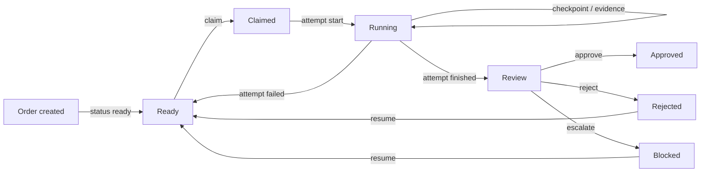
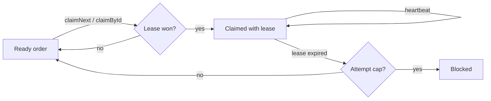
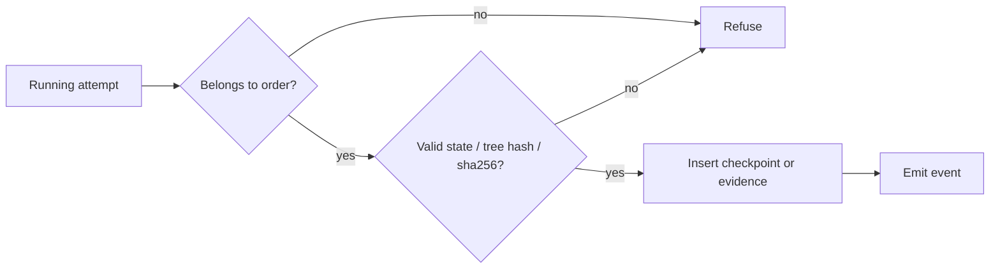
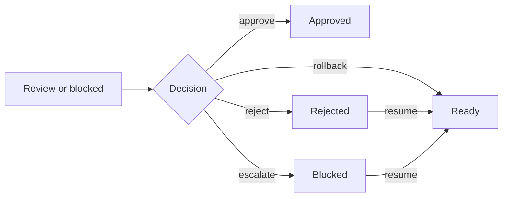

# Brayer

**Ink the work, not the transcript.**

Brayer is a vendor-neutral command layer for agent work. It records a work order,
the attempts made against it, the handoff checkpoint, the evidence returned, and
the verdict — so a fleet of coding agents can be supervised by exception instead
of by transcript.

## Why Brayer

A brayer is the printer's small hand roller that applies ink evenly to type. It
does not rewrite the page, and it does not keep the manuscript. It puts the ink
exactly where the work needs it.

Brayer does the same for agents. It applies context to the work — the order, the
checkpoint, the proof, the decision — instead of piling another transcript into
the context window.

The product is a command layer, not another agent:

- **Work order in** — goal, acceptance, workspace, budget, approval mode.
- **Handoff out** — a structured checkpoint with a tree hash, not a transcript.
- **Evidence attached** — diff, tests, screenshots, artifacts, all content-addressed.
- **Verdict recorded** — approve, reject, escalate or rollback, with an audit event.
- **Resume exact** — a leased attempt can die and continue in any harness without a re-brief.

## Who it is for

Technical operators who run several coding agents across repos and harnesses and
need to supervise by exception, not by reading every trace. It is local-first and
vendor-neutral: OpenCode, OpenClaw and future harnesses are adapters, not the
product. It is also planning-system agnostic: a work order is
self-contained, and no external planner task id is required.

## Status

Brayer is in active development. The MCP server, SQLite store, claim lease,
attempts, checkpoints, evidence, verdicts, resume, event stream, HTTP MCP,
claim webhooks and the OpenCode/OpenClaw identity plugins are implemented.

## Install

Brayer is published to public npm:

```sh
npm install -g @igorjpimenta/brayer@beta
brayer --version
```

## What works

```sh
# MCP over stdio for one harness
BRAYER_HARNESS=opencode brayer serve --mcp stdio

# MCP over HTTP with bearer auth
BRAYER_HARNESS=openclaw BRAYER_MCP_BEARER=secret \
  brayer serve --mcp http --port 38293

# Event stream for dashboards and inboxes
brayer serve --ws --port 38294

# Read the queue
brayer status
brayer status --json

# Register a claim wake target
brayer webhook set --harness opencode \
  --url http://127.0.0.1:38295/api/brayer/claimed --bearer secret
brayer webhook test --harness opencode
```

The MCP tools are:

| Area | Tools |
| --- | --- |
| Orders | `brayer_order_create`, `brayer_order_get`, `brayer_order_next`, `brayer_order_claim`, `brayer_order_heartbeat`, `brayer_order_resume` |
| Attempts | `brayer_attempt_start`, `brayer_attempt_finish`, `brayer_attempt_get` |
| Handoff | `brayer_checkpoint_write`, `brayer_checkpoint_get` |
| Evidence | `brayer_evidence_attach`, `brayer_evidence_list` |
| Verdict | `brayer_verdict_issue`, `brayer_verdict_list` |

## Flows

### Order lifecycle

An order moves from ready through a claim and a running attempt to review. The
verdict decides where it lands, and resume returns rejected or blocked work to
ready.



### Claim and lease

An agent claims a ready order, then keeps the lease alive with heartbeats. An
expired lease returns to the queue or blocks at the attempt cap.



### Checkpoint and evidence

The store validates the attempt and the handoff or proof before it records the
row and emits the event.



### Verdict and resume

A verdict closes review or blocked work. Reject and escalate remain resumable;
rollback returns the order to ready directly.



## Storage

- SQLite at `BRAYER_DB` or `~/.brayer/store.sqlite`
- Content-addressed evidence at `BRAYER_BLOBS` or `~/.brayer/blobs/<sha256>`
- Drizzle migrations in `.migrations/`, applied on open
- WAL, foreign keys and a 5s busy timeout

## Configuration

Explicit config beats `BRAYER_*` env beats defaults. Integer knobs refuse
malformed values; unknown explicit keys refuse as typos.

| Knob | Env | Default |
| --- | --- | --- |
| Store | `BRAYER_DB` | `~/.brayer/store.sqlite` |
| Blobs | `BRAYER_BLOBS` | `~/.brayer/blobs` |
| Lease | `BRAYER_LEASE_SECONDS` | `1800` |
| Attempt cap | `BRAYER_MAX_ATTEMPTS` | `3` |
| HTTP port | `BRAYER_HTTP_PORT` | `38293` |
| WS port | `BRAYER_WS_PORT` | `38294` |
| HTTP MCP bearer | `BRAYER_MCP_BEARER` | required for HTTP |
| Claim webhook URL | `BRAYER_CLAIM_WEBHOOK_URL` | unset |
| Claim webhook bearer | `BRAYER_CLAIM_WEBHOOK_BEARER` | unset |
| Claim webhook timeout | `BRAYER_CLAIM_WEBHOOK_TIMEOUT_MS` | `3000` |
| Per-harness webhooks | `BRAYER_CLAIM_WEBHOOKS` | `{}` |
| Wake bridge port | `BRAYER_WAKE_PORT` | `38295` |
| Wake bridge bearer | `BRAYER_WAKE_BEARER` | unset |
| OpenCode server URL | `BRAYER_OPENCODE_URL` | `http://127.0.0.1:4096` |

## Identity

Every call is keyed `harness:agent:session`. The harness is declared at
construction (`BRAYER_HARNESS`); the agent and session are stamped per call via
`_meta.brayer` with `brayer_agent` / `brayer_session` as the fallback. Missing or
mismatched identity refuses the call.

## Harnesses

An adapter attaches an existing order; it never creates work.

**OpenClaw** — `@igorjpimenta/brayer-openclaw` stamps `_meta.brayer`, checkpoints
on turn end, resumes from the latest checkpoint, and receives claim webhooks at
`POST /api/brayer/claimed`.

```json
{
  "mcp": {
    "servers": {
      "brayer": {
        "command": "brayer",
        "args": ["serve", "--mcp", "stdio"],
        "env": { "BRAYER_HARNESS": "openclaw" }
      }
    }
  }
}
```

**OpenCode** — `@igorjpimenta/brayer-opencode` stamps agent/session identity on
Brayer MCP tool calls. It needs the Brayer MCP server configured and
`BRAYER_AGENT` when the session agent cannot be captured.

```json
{
  "mcp": {
    "brayer": {
      "type": "remote",
      "url": "http://127.0.0.1:38293/mcp",
      "headers": { "Authorization": "Bearer secret" }
    }
  },
  "plugin": ["@igorjpimenta/brayer-opencode"]
}
```

Automatic checkpoint/resume is not part of this release; the agent uses the
Brayer MCP tools directly.

**Wake bridge** — the OpenCode package also ships the optional `brayer-wake` bin.
It receives the claim webhook and prompts the claiming session through the
OpenCode SDK.

## Docker

```sh
BRAYER_MCP_BEARER=secret docker compose up --build
```

The image stores SQLite and blobs on the `brayer-data` volume at `/data`;
HTTP MCP is exposed on 38293 and the event stream on 38294.

## Release

Versions are CalVer (`YYYY.MM.DD-beta.N`). Tags are bare for core and prefixed
for adapters: `brayer-openclaw-<calver>` and `brayer-opencode-<calver>`.
Prereleases publish to `beta`; stable tags publish to `latest`.

## Development

```sh
npm install
npm test
node bin/brayer.js --help
```

## License

MIT
