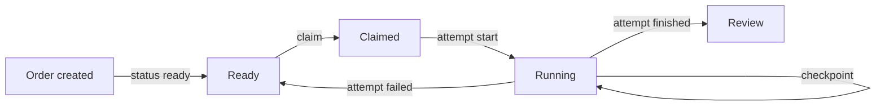
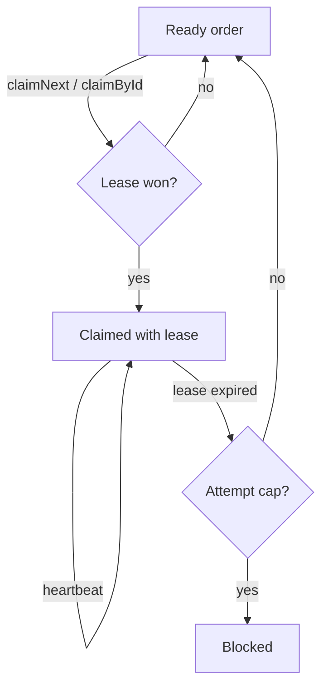
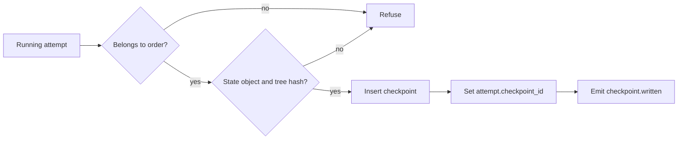

# brayer

Brayer is a vendor-neutral command layer for agent work. It records a work order,
the attempts made against it, the handoff checkpoint, the evidence returned, and
the verdict — so a fleet of coding agents can be supervised by exception instead
of by transcript.

## Status

Brayer is in active development. The MCP server, SQLite store, claim lease,
attempts and checkpoints are implemented.

## What works

```sh
# MCP over stdio for one harness
BRAYER_HARNESS=claude brayer serve --mcp stdio
```

The MCP tools are:

| Area | Tools |
| --- | --- |
| Orders | `brayer_order_create`, `brayer_order_get`, `brayer_order_next`, `brayer_order_claim`, `brayer_order_heartbeat` |
| Attempts | `brayer_attempt_start`, `brayer_attempt_finish`, `brayer_attempt_get` |
| Handoff | `brayer_checkpoint_write`, `brayer_checkpoint_get` |

## Flows

Order lifecycle:



Claim and lease:



Checkpoint write:



## Storage

- SQLite at `BRAYER_DB` or `~/.brayer/store.sqlite`
- Drizzle migrations in `.migrations/`, applied on open
- WAL, foreign keys and a 5s busy timeout

## Configuration

Explicit config beats `BRAYER_*` env beats defaults. Integer knobs refuse
malformed values; unknown explicit keys refuse as typos.

| Knob | Env | Default |
| --- | --- | --- |
| Store | `BRAYER_DB` | `~/.brayer/store.sqlite` |
| Lease | `BRAYER_LEASE_SECONDS` | `1800` |
| Attempt cap | `BRAYER_MAX_ATTEMPTS` | `3` |

## Identity

Every call is keyed `harness:agent:session`. The harness is declared at
construction (`BRAYER_HARNESS`); the agent and session are stamped per call via
`_meta.brayer` with `brayer_agent` / `brayer_session` as the fallback. Missing or
mismatched identity refuses the call.

## Requirements

- Node 22+
- A writable SQLite path

## Development

```sh
npm install
npm test
node bin/brayer.js --help
```

## License

MIT
