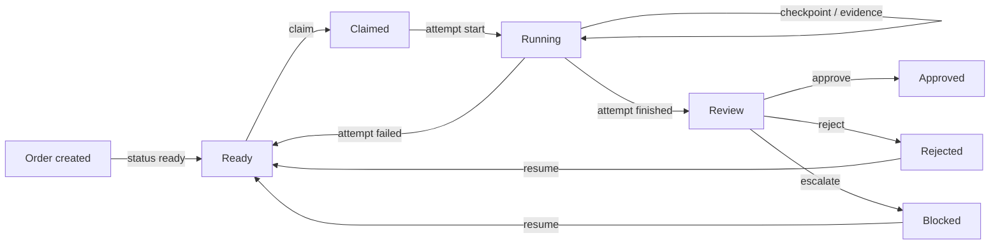
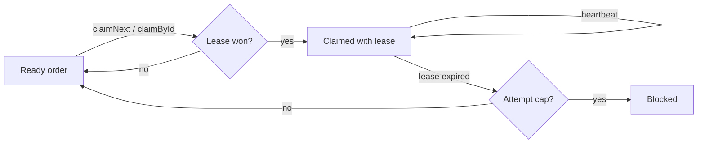
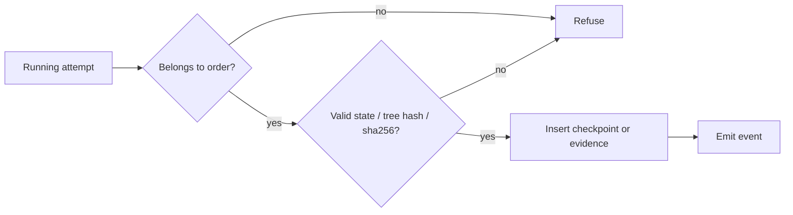
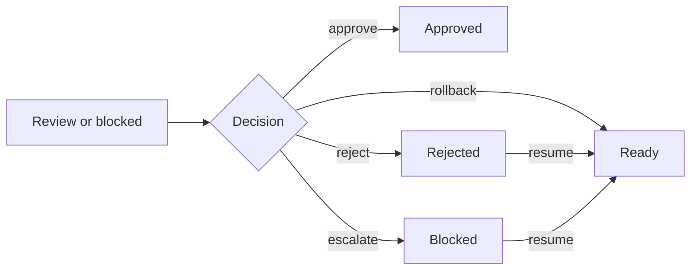

# Lifecycle

The state contracts enforced by the store. The store validates every transition
before it records the row and emits the event.

## Order lifecycle

An order moves from ready through a claim and a running attempt to review. The
verdict decides where it lands; resume returns rejected or blocked work to
ready.

## Claim and lease

An agent claims a ready order (`claim_next` or `claim` by id — atomic, the race
loser gets nothing), then keeps the lease alive with heartbeats. An expired
lease returns the order to the queue, or blocks at the attempt cap.

`claim` and `claim_next` accept `start_attempt: true`, which opens the running
attempt in the same call. The OpenCode adapter always sets it: the lease only
guards the claimed → attempt window, so collapsing that window removes the
common 30-minute expiry. An attempt in `running` state is not swept on lease
expiry; heartbeat remains for manually claimed orders that have not started.

Defaults: lease `1800` s, attempt cap `3` (see
[configuration](configuration.md)).

An order that never started running can be retired with
`brayer_order_cancel` (or `brayer order cancel --id`): it clears the claim,
sets `closed_at`, and records `order.cancelled`. Running orders are refused —
finish or fail the attempt first; approved, rejected and done orders are
terminal.

## Checkpoint and evidence

The store validates the attempt and the handoff or proof before it records the
row and emits the event.

Evidence attach is an attempt-time action: it must land before
`attempt_finish`, because verdict approvals require at least one evidence row
and evidence cannot be added after the attempt closes.

## Verdict and resume

A verdict closes review or blocked work. Reject and escalate remain resumable;
rollback returns the order to ready directly.

Approve requires at least one evidence row on the attempt
(`brayer_verdict_issue` refuses otherwise).

## Adoption scorecard

`brayer adoption --days N --harness H` reports real orders claimed per week,
claim → attempt within five minutes, attempts with a verdict, lease expiries,
usage reporting and median claim → attempt latency. An order counts as **real**
only when `workspace` is set: proof and gate orders omit it, so scaffolding
does not inflate demand. A clean queue is not a success signal — claims without
attempts are the failure this measures.

## Identity refusal contract

Every mutating call carries a full `harness:agent:session` identity. The store
refuses the call — the order is untouched — when:

- the harness is missing (any non-empty name is accepted; deliverability is
  checked at claim time, not by name);
- a claim is made for an undeclared wake route — a claimed order that no one
  could be woken for is invisible work, so
  `brayer_order_claim` / `brayer_order_next` refuse with instructions to
  register the route (`brayer webhook set --harness <h>` or the claim-webhook
  config);
- agent/session halves arrive in different channels (one via `_meta.brayer`,
  one via args) — *pairs never splice*;
- a forged or mismatched identity reaches a call gated by the adapter.

Refusal surfaces as a tool error and an audit trail keeps the order state
clean.
