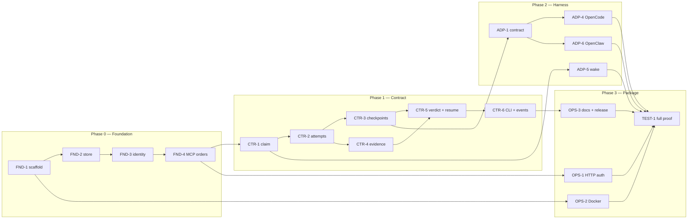

# Brayer roadmap

Brayer is a vendor-neutral command layer for agent work: work orders in, durable
handoffs out, evidence-based approval, cost per successful task. It sits above
Claude Code, Codex, OpenCode, OpenClaw and future harnesses; it is not another
agent and it is not a planner.

This document is the delivery plan and dependency map. It is the source of truth
for story ids, stack order and merge order.

**Status (28 Oct 2026):** Phase 0 and Phase 1 are implemented on `main`.
PRs #2–#11 delivered the contract; #12–#15 landed the rename, the
planning-agnostic boundary and the store/tool/test splits. The next story is
ADP-1, the adapter contract.

## Scope decisions

- **No Winch bridge.** #13 removed planner coupling; Brayer does not share
  tables or ids with Winch. Planners create orders through the public contract.
- **Adapters attach to existing orders.** An adapter never creates work. It
  claims an explicit order and resumes against that stable id.
- **Checkpoints are best-effort automatic.** Adapters checkpoint on idle,
  compaction and error, and expose an explicit checkpoint tool.
- **Package first.** Ship HTTP MCP auth, Docker, release workflow and install
  tests before any Phase 4 work.

## Delivery rules

- `main` receives only the empty initial commit directly. Everything else lands
  through a pull request.
- One worktree per story. Parallel work gets parallel worktrees.
- One PR per story, with the story's commits bundled. Angular commit convention:
  `feat:`, `fix:`, `docs:`, `refactor:`, `test:`, `chore:`.
- A story that depends on an open PR branches from that PR's branch and targets
  it as the PR base. When the parent lands, rebase the child onto `main` and
  retarget the PR.
- Unit tests mirror source under `test/unit/`. Shared helpers live in
  `test/helpers/`. `npm test` runs `node --test "test/unit/**/*.js"`.
- Every commit runs the comment policy scan before landing.

## Phases

| Phase | Theme | Exit proof |
| --- | --- | --- |
| 0 — Foundation | Package, store, identity, MCP orders | `brayer serve --mcp stdio` starts and a smoke call succeeds |
| 1 — Contract | Claims, attempts, checkpoints, evidence, verdicts, events | One order moves create → claim → checkpoint → finish → verdict |
| 2 — Harness | Adapter contract, OpenCode, OpenClaw, wake | A killed OpenCode or OpenClaw session resumes from checkpoint with no re-brief |
| 3 — Package | HTTP auth, Docker, docs, release | `npm pack` installs and serves; container persists a volume; HTTP refuses unauthenticated calls |
| 4 — Deferred | Playbooks, eval, team/cloud | Not in the current package milestone |

## Dependency graph

## Stories

| ID | Story | Phase | Depends on | PR base | Exit criterion |
| --- | --- | --- | --- | --- | --- |
| FND-1 | Scaffold package, bin, CI, test harness | 0 | — | `main` | `npm test` passes; CI runs on PR |
| FND-2 | Store schema, migrations, SQLite, order primitives | 0 | FND-1 | `chore/scaffold` | Migrations apply; order create/get round-trips |
| FND-3 | Identity and config: `harness:agent:session` | 0 | FND-2 | `feat/store-foundation` | Unstamped calls fail; declared harness works |
| FND-4 | MCP stdio server and order tools | 0 | FND-2, FND-3 | `feat/identity-config` | Smoke call returns an order |
| CTR-1 | Claim next/by-id with CAS lease and sweeper | 1 | FND-4 | `feat/mcp-orders` | Two processes race; one wins; lease expires |
| CTR-2 | Attempt start/finish; one live attempt per order | 1 | CTR-1 | `feat/claim-lease` | Attempt lifecycle writes one event per transition |
| CTR-3 | Checkpoint write/get; structured handoff, tree hash | 1 | CTR-2 | `feat/attempts` | Checkpoint survives process restart |
| CTR-4 | Evidence attach; content-addressed blobs | 1 | CTR-2 | `feat/attempts` | Missing blob refused; hash verifies |
| CTR-5 | Verdict issue/resume | 1 | CTR-3, CTR-4 | `feat/checkpoints` | Verdict moves the order; resume returns its checkpoint |
| CTR-6 | CLI status/inbox and WS event stream | 1 | CTR-1, CTR-5 | `feat/verdict-resume` | Events replay on reconnect; `brayer status` reads the ledger |
| ADP-1 | Adapter contract and generic MCP adapter | 2 | CTR-3 | `main` | Contract tests pass against a fixture adapter |
| ADP-4 | OpenCode adapter: attach, checkpoint, resume | 2 | ADP-1 | `feat/adapter-contract` | Kill/resume proof with no re-brief |
| ADP-5 | Claim webhook and wake routing | 2 | CTR-1, ADP-1 | `feat/adapter-contract` | Claim wakes the assignee once; retries are idempotent |
| ADP-6 | OpenClaw adapter: attach, checkpoint, resume | 2 | ADP-1 | `feat/adapter-contract` | Kill/resume proof with no re-brief |
| OPS-1 | HTTP MCP bearer auth and `serve --mcp http` | 3 | FND-4 | `main` | Unauthenticated call refused; authenticated call succeeds |
| OPS-2 | Dockerfile and compose | 3 | FND-1 | `main` | Container starts with a persistent volume |
| OPS-3 | README, adapter docs, release workflow | 3 | CTR-6 | `main` | `npm pack` installs; release workflow dry-run passes |
| TEST-1 | Full package proof | 3 | ADP-4, ADP-5, ADP-6, OPS-1, OPS-2, OPS-3 | `main` | Adapter E2E, HTTP auth, container, and tarball install all pass |
| CMP-1 | Playbook compiler from accepted work | 4 | CTR-5, CTR-6 | deferred | One accepted task promotes one playbook |
| CMP-2 | Eval gate for playbook promotion | 4 | CMP-1 | deferred | A regression blocks promotion |
| CMP-3 | Team/cloud sync and audit | 4 | OPS-3, CMP-2 | deferred | Two operators share one inbox |

## Adapter contract

An adapter is a thin harness plugin, not a planner.

1. Resolve an **existing order id** from `BRAYER_ORDER_ID` or an explicit tool
   call. Never create an order from a session prompt.
2. Attach the session as `harness:agent:session`:
   - resume `rejected` or `blocked` to `ready`;
   - claim a `ready` order;
   - start an attempt on a `claimed` order;
   - reuse a live `running` attempt for the same agent.
3. Checkpoint on idle, compaction and error with a structured state object and
   tree hash. The explicit checkpoint tool remains available.
4. Attach evidence (diff, tests, logs) before finishing.
5. Resume by returning the order plus its latest checkpoint to the new session.
   The harness injects the checkpoint as its first context; no transcript replay.

The generic MCP adapter is the existing `brayer serve --mcp stdio` server plus
`BRAYER_HARNESS`; it needs no harness-specific code.

## Critical path

`ADP-1 → ADP-4 / ADP-6 → ADP-5 → OPS-1/2/3 → TEST-1`

The shortest proof is a killed OpenCode or OpenClaw session resumed from a
checkpoint with no re-brief. The package is done when a tarball install, an HTTP
MCP call with bearer auth, and a Docker run with a volume all pass the same
smoke test.

## Metrics

North star: **verified tasks completed per human hour**.

| Metric | Target | Source |
| --- | --- | --- |
| Resume success | ≥95% | attempts resumed from a checkpoint with a completed verdict |
| Re-brief tokens | −70% | tokens before first tool call on resumed vs fresh attempt |
| Human minutes per 100 tasks | −30% | approval inbox timestamps |
| First-pass acceptance | ≥70% | verdicts without a reject/resume cycle |
| Cost per successful task | −25% | attempt cost / approved verdicts |
| Tool-error recovery | ≥90% | attempts that finish after an error checkpoint |
| Context-loss rate | <1% | orders with no checkpoint at lease expiry |

## Risks

| Risk | Mitigation |
| --- | --- |
| Adapter session formats drift | Contract tests per harness; version the adapter; fail capture loudly |
| Adapter turns into a planner | Attach to an explicit order id; no create-from-session path |
| MCP payload limits for diffs/logs | Evidence rows store `uri + sha256 + summary`; blobs stay outside the call |
| Identity spoofing | Plugin overwrites `_meta`; no default agent/session |
| SQLite single writer | One daemon, WAL, short `BEGIN IMMEDIATE`, CLI writes through the daemon |
| HTTP exposure | Bearer auth required for non-loopback; health probe is the only anonymous route |
| Scope creep into playbooks | Freeze Phase 4 until the package and both adapters pass TEST-1 |
