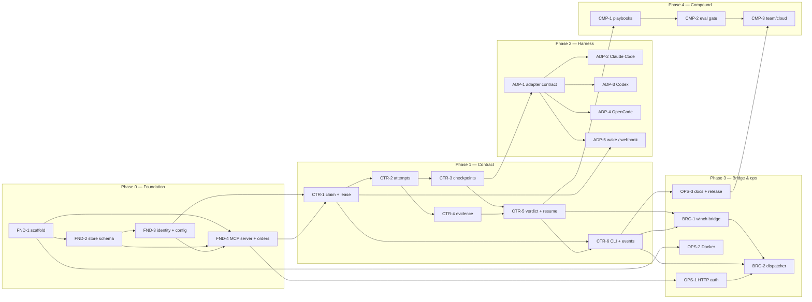

# Baton roadmap

Baton is a vendor-neutral command layer for agent work: work orders in, durable
handoffs out, evidence-based approval, cost per successful task. It sits above
Claude Code, Codex, OpenCode and any future harness; it is not another agent.

This document is the delivery plan and the dependency map. It is the source of
truth for story ids, stack order and merge order.

## Delivery rules

- `main` receives only the empty initial commit directly. Everything else lands
  through a pull request.
- One worktree per story. Parallel work gets parallel worktrees.
- One PR per story, with the story's commits bundled. Angular commit convention:
  `feat:`, `fix:`, `docs:`, `refactor:`, `test:`, `chore:`.
- A story that depends on an open PR branches from that PR's branch and targets
  it as the PR base. When the parent lands, rebase the child onto `main` and
  retarget the PR.
- Every commit runs the comment policy scan before landing:
  `node /Users/herculano/.doppler/skills/comment-policy/scan.mjs --diff main`.

## Phases

| Phase | Theme | Exit proof |
| --- | --- | --- |
| 0 — Foundation | A package that starts, a store that migrates, identity that refuses defaults, an MCP server that answers | `baton serve --mcp stdio` starts and a smoke tool call succeeds |
| 1 — Contract | Orders, claims, attempts, checkpoints, evidence, verdicts, events | One order moves create → claim → checkpoint → finish → verdict |
| 2 — Harness | Adapter contract and the first three harness adapters | A Claude Code session killed mid-task resumes from checkpoint with no re-brief |
| 3 — Bridge & ops | Winch bridge, HTTP auth, packaging, docs | Winch `task.assigned` creates an order; approved verdict closes the task |
| 4 — Compound | Playbooks, eval gate, team/cloud | Accepted work improves the next run; token per successful task falls |

## Dependency graph



## Stories

| ID | Story | Phase | Depends on | PR base | Exit criterion |
| --- | --- | --- | --- | --- | --- |
| FND-1 | Scaffold package, bin, CI, test harness, docs skeleton | 0 | — | `main` | `npm test` passes; CI runs on PR |
| FND-2 | Store schema, migrations, SQLite open, order primitives | 0 | FND-1 | `chore/scaffold` | Migrations apply; order create/get round-trips |
| FND-3 | Identity and config: `harness:agent:session`, refusal, precedence | 0 | FND-2 | `feat/store-foundation` | Unstamped calls fail; declared harness works |
| FND-4 | MCP stdio server and order create/get tools | 0 | FND-2, FND-3 | `feat/identity-config` | Smoke call returns an order |
| CTR-1 | Claim next/by-id with CAS lease and sweeper | 1 | FND-4 | `feat/mcp-orders` | Two processes race; one wins; lease expires |
| CTR-2 | Attempt start/finish; one live attempt per order | 1 | CTR-1 | `feat/claim-lease` | Attempt lifecycle writes one event per transition |
| CTR-3 | Checkpoint write/get; structured handoff, tree hash | 1 | CTR-2 | `feat/attempts` | Checkpoint survives process restart |
| CTR-4 | Evidence attach; content-addressed blobs | 1 | CTR-2 | `feat/attempts` | Missing blob is refused; hash verifies |
| CTR-5 | Verdict issue/resume; gate vs verdict | 1 | CTR-3, CTR-4 | `feat/checkpoints` | High-risk blocks; low-risk auto-approves |
| CTR-6 | CLI status/inbox and WS event stream | 1 | CTR-1, CTR-5 | `feat/verdict-resume` | Events replay on reconnect; `baton status` reads the ledger |
| ADP-1 | Adapter contract and generic MCP adapter | 2 | CTR-3 | `feat/checkpoints` | Contract tests pass against a fixture |
| ADP-2 | Claude Code adapter: capture, checkpoint, resume | 2 | ADP-1 | `feat/adapter-contract` | Kill/resume proof with no re-brief |
| ADP-3 | Codex adapter | 2 | ADP-1 | `feat/adapter-contract` | Resume a Codex session from a checkpoint |
| ADP-4 | OpenCode adapter | 2 | ADP-1 | `feat/adapter-contract` | Resume an OpenCode session from a checkpoint |
| ADP-5 | Claim webhook and wake routing | 2 | CTR-1, ADP-1 | `feat/claim-lease` | Claim wakes the assignee once |
| BRG-1 | Winch bridge contract: task ↔ order | 3 | CTR-5, CTR-6 | `feat/verdict-resume` | `task.assigned` creates an order |
| BRG-2 | Bridge dispatcher with replay and idempotency | 3 | BRG-1, CTR-6 | `feat/winch-bridge` | Approved verdict closes the winch task |
| OPS-1 | HTTP bearer auth and `serve --mcp http` | 3 | FND-4 | `feat/mcp-orders` | Unauthenticated call is refused |
| OPS-2 | Dockerfile and compose | 3 | FND-1 | `chore/scaffold` | Container starts with a volume |
| OPS-3 | README, adapter docs, release workflow | 3 | CTR-6 | `feat/cli-events` | Docs match the shipped contract |
| CMP-1 | Playbook compiler from accepted work | 4 | CTR-5, CTR-6 | `main` after M3 | One accepted task promotes one playbook |
| CMP-2 | Eval gate for playbook promotion | 4 | CMP-1 | `feat/playbooks` | A regression blocks promotion |
| CMP-3 | Team/cloud sync and audit | 4 | OPS-3, CMP-2 | `main` after M4 | Two operators share one inbox |

## Critical path

`FND-1 → FND-2 → FND-3 → FND-4 → CTR-1 → CTR-2 → CTR-3 → ADP-1 → ADP-2`

The shortest proof of the product is a killed Claude Code session resumed from a
checkpoint with no re-brief. `CTR-5` (verdict) and `CTR-6` (events) are the next
proof: the operator can approve by evidence. Everything else is expansion.

## Current delivery slice

Phase 0 and Phase 1 are the current slice. They are implemented as a linear
stack of worktrees and PRs:

```text
main
└── chore/scaffold                 FND-1
    └── feat/store-foundation      FND-2
        └── feat/identity-config   FND-3
            └── feat/mcp-orders    FND-4
                └── feat/claim-lease   CTR-1
                    └── feat/attempts  CTR-2
                        ├── feat/checkpoints  CTR-3
                        │   └── feat/verdict-resume  CTR-5
                        └── feat/evidence     CTR-4
                            └── feat/verdict-resume  CTR-5
                                └── feat/cli-events  CTR-6
```

A story with two dependencies stacks on the earlier one; `CTR-5` is the join
point for checkpoints and evidence. `CTR-6` stacks on `CTR-5`.

## Metrics

North star: **verified tasks completed per human hour**.

| Metric | Target | Source |
| --- | --- | --- |
| Resume success | ≥95% | `attempts` with `resumed_from` checkpoint and a completed verdict |
| Re-brief tokens | −70% | tokens before first tool call on resumed attempt vs fresh attempt |
| Human minutes per 100 tasks | −30% | approval inbox timestamps |
| First-pass acceptance | ≥70% | verdicts without a reject/resume cycle |
| Cost per successful task | −25% | attempt cost / approved verdicts |
| Tool-error recovery | ≥90% | attempts that finish after an error checkpoint |
| Context-loss rate | <1% | orders with no checkpoint at lease expiry |

## Risks

| Risk | Mitigation |
| --- | --- |
| Adapter session formats drift | Contract tests per harness; version the adapter; fail capture loudly |
| MCP payload limits for diffs/logs | Evidence rows store `uri + sha256 + summary`; blobs stay outside the tool call |
| Identity spoofing | Plugin overwrites `_meta` unconditionally; no default agent/session |
| SQLite single writer | One daemon, WAL, short `BEGIN IMMEDIATE`, CLI writes through the daemon |
| Scope creep into routing/playbooks | Freeze Phase 0–1 at the contract; add routing only after 1k accepted tasks |
| Winch coupling | Separate DB; nullable `winch_task_id`; bridge by events, not shared tables |
